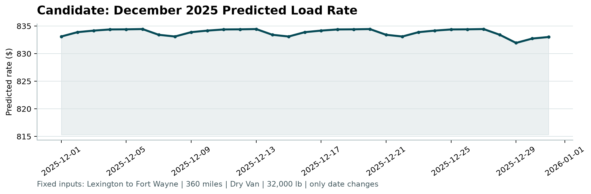

# Freight Rate Prediction — Write-up

## Data

`train_test.csv` holds 48,000 labeled loads from 2025-01-01 to 2025-10-31 across 64 pickup and 64 delivery cities and 3 equipment types (Dry Van, Flatbed, Reefer). The target is `posted_rate` (USD). `validation.csv` covers 2025-11-01 to 2025-12-31 (12,000 rows) and is the final out-of-sample scoring set.

## Data quality

- **Negative / zero weights** — 292 rows have `weight <= 0` (minimum -47,500). Treated as missing and imputed with the training median (~31,436 lb).
- **Missing values** — `weight` missing in 300 train / 165 val rows, `market_index` missing in 374 train / 249 val rows. Both median-imputed; medians fit on training only to avoid leakage.
- **Rate-per-mile outliers** — 99.9th percentile of posted_rate is $12.8k with a max of $25.5k. Instead of clipping, the model is trained on `log1p(posted_rate)` with absolute-error loss so a few extremes don't dominate.
- **Unseen cities in validation** — ~6% of val rows have pickup or delivery cities not present in training. The gradient-boosted model handles these via haversine distance and lat/lon features, which carry most of the signal when the city label itself is unknown.

## Features

| Feature | Why |
|---|---|
| `distance` | Correlation 0.91 with rate — the dominant driver. |
| `haversine` (from lat/lon) | Robust fallback when the city label is unseen; also catches cases where `distance` is noisy. |
| `equipment` | Rate per mile differs by equipment (Reefer $2.38 > Flatbed $2.29 > Dry Van $2.11). |
| `weight` | Minor signal, kept after cleaning. |
| `market_index`, `quote_signal` | Market/quote context. |
| `pickup`, `delivery` | Native categoricals — captures lane effects beyond distance. |
| `dayofweek`, `dayofyear`, `month`, `week` | Seasonal and weekday effects. |

## Model

`sklearn.ensemble.HistGradientBoostingRegressor` with absolute-error loss, native categorical handling, and the target on log scale. Chosen over LightGBM / XGBoost because:
- No external native dependency (no `libomp` on macOS) — easy to reproduce.
- Native categorical support, so no high-cardinality one-hot blow-up for the 64 cities.
- Absolute-error loss plus `log1p` target is robust to the few $20k+ outliers.

Key hyperparameters: `learning_rate=0.05`, `max_leaf_nodes=63`, `min_samples_leaf=40`, `max_iter=1200`, early stopping on 10% internal validation when fitting the holdout model.

## Validation approach

Because `validation.csv` is the future (Nov–Dec vs. a Jan–Oct training window), a time-based holdout is the only honest split. The last 30 days of training (`2025-10-02` to `2025-10-31`) are the holdout; the first ~9 months are the fit set.

**Holdout metrics** (log target, metrics reported in dollars):

| Metric | Value |
|---|---|
| MAE | $101.22 |
| MAPE | 4.87% |

Random k-fold would leak future information into the training folds and overstate performance, so I didn't use it.

Once the holdout number was accepted, the final submitted model was refit on **all** 48,000 rows with the same hyperparameters.

## December chart

Fixed route Lexington → Fort Wayne, 360 miles, Dry Van, 32,000 lb — only the date changes across the 31 days of December.



Predictions sit around $833 (~$2.32/mi), close to the training average for the Lexington → Fort Wayne lane ($856, 32 samples). Day-to-day movement is small and comes from the dayofweek effect learned from training; raw ordinal date features (dayofyear, week, month) can't extrapolate past October in a tree model, so the shape is intentionally smooth rather than invented trend.

One subtle fix worth calling out: the dataset's `pickup_lat`/`pickup_lon` for each city are not the real geographic coordinates — they're the dataset's own fixed per-city values. For the fixed December route I pull them straight from the training file so the haversine feature matches what the model saw during training; using Google-maps coords put December in the wrong leaf and dropped the baseline by ~$40.

## Reproducing

```bash
python -m venv .venv && source .venv/bin/activate
pip install -r requirements.txt
python -m src.train
python -m src.predict
python score.py --predictions validation_predictions.csv --december-predictions data/december_chart_inputs.csv
```
